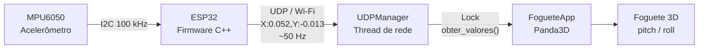

# 🚀 Foguete 3D Controlado por Acelerômetro

> Incline um sensor na mão e veja um foguete 3D se inclinar igual na tela, em tempo real, via Wi-Fi.

Projeto de estudo que conecta **hardware embarcado** e **computação gráfica**: um **ESP32** lê um acelerômetro **MPU6050** via I2C e transmite a inclinação por **Wi-Fi (UDP)** para um programa em **Python** que renderiza e rotaciona um foguete 3D com **Panda3D**.

<!-- Substitua pelo link do seu vídeo e/ou GIF de demonstração -->
**🎥 Demonstração:** _em breve (vídeo no YouTube)_

<!--  -->

---

## 📑 Sumário

- [Visão geral](#-visão-geral)
- [Funcionalidades](#-funcionalidades)
- [Arquitetura](#-arquitetura)
- [Hardware](#-hardware)
- [Estrutura do repositório](#-estrutura-do-repositório)
- [Como executar](#-como-executar)
- [Protocolo de comunicação](#-protocolo-de-comunicação)
- [Como funciona por dentro](#-como-funciona-por-dentro)
- [Parâmetros ajustáveis](#-parâmetros-ajustáveis)
- [Problemas comuns](#-problemas-comuns)
- [Conceitos praticados](#-conceitos-praticados)
- [Próximos passos](#-próximos-passos)
- [Licença](#-licença)

---

## 🔭 Visão geral

O projeto nasceu como uma trilha de estudos dividida em quatro etapas:

| Etapa | Foco | Resultado |
|---|---|---|
| 1 | ESP32 + MPU6050 via I2C | Valores de aceleração lidos direto dos registradores do chip |
| 2 | Comunicação com o PC | Dados enviados por Serial (UART) e por Wi-Fi (UDP) |
| 3 | Computação gráfica | Foguete 3D procedural controlado por teclado no Panda3D |
| 4 | Integração | O sensor físico substitui o teclado e controla o foguete |

Depois da integração, foram adicionados calibração automática de offset, suavização do sinal e um watchdog de perda de conexão.

---

## ✨ Funcionalidades

- **Leitura direta de registradores** do MPU6050 (sem biblioteca de alto nível), o que também funciona com módulos clones que falham na checagem `WHO_AM_I`.
- **Recuperação automática do barramento I2C**: detecta falha de leitura e gera 9 pulsos de clock manuais em SCL, com condição de STOP, para destravar o sensor.
- **Dois canais de comunicação**: Serial/USB e Wi-Fi/UDP, com o mesmo protocolo de texto.
- **Parsing defensivo** no Python: linhas corrompidas são descartadas sem derrubar o programa.
- **Recepção em thread separada** com `Lock`, sem race conditions entre a rede e o loop gráfico.
- **Foguete 3D procedural**: corpo, coifa, tubeira, quatro aletas e chama animada, construídos vértice a vértice.
- **Movimento independente de frame rate** (delta time) e **limite de ângulo** (±45°).
- **Suavização** por média móvel exponencial para filtrar o ruído do sensor.
- **Calibração automática (tare)**: as primeiras 50 amostras definem o zero da sessão.
- **Watchdog**: se o sensor parar de enviar dados, o foguete volta à posição neutra.

---

## 🧩 Arquitetura



**Fluxo dos dados no PC:**

```
Pacote UDP → decodifica → valida formato → calibração (offset)
          → mapeia g → graus → suavização (EMA) → clamp ±45° → setP / setR
```

---

## 🔌 Hardware

### Componentes

| Qtd | Item |
|---|---|
| 1 | Placa ESP32 (DevKit, ex.: ESP32-WROOM-32) |
| 1 | Módulo acelerômetro/giroscópio MPU6050 (GY-521) |
| 4 | Jumpers |
| 1 | Cabo USB (gravação do firmware) |
| 1 | Rede Wi-Fi **2,4 GHz** |

### Ligações

| MPU6050 | ESP32 |
|---|---|
| VCC | 3V3 |
| GND | GND |
| SDA | GPIO 21 |
| SCL | GPIO 22 |

> ⚠️ Como o sensor é movido na mão, jumpers de protoboard podem soltar e travar o barramento I2C. Para uso contínuo, prefira solda ou fios fixados com alívio de tensão.

---

## 📁 Estrutura do repositório

```
.
├── foguete_c++/                 # Firmware do ESP32 (PlatformIO)
│   ├── platformio.ini
│   └── src/
│       └── main.cpp
│
└── foguete_py/                  # Aplicação no PC
    ├── main.py                  # Ponto de entrada
    ├── esp32_comunication.py    # UDPManager (rede, thread, calibração)
    └── rocket_simulator.py      # FogueteApp (cena 3D e controle)
```

---

## ▶️ Como executar

### 1. Firmware (ESP32)

**Requisitos:** VSCode com a extensão **PlatformIO IDE**.

1. Abra a pasta `foguete_c++` no VSCode.
2. Confira o `platformio.ini`:

   ```ini
   [env:esp32dev]
   platform = espressif32@6.9.0
   board = esp32dev
   framework = arduino
   monitor_speed = 115200
   ```

   > A versão da plataforma está fixada em `6.9.0` para evitar um erro de instalação no Windows causado pelo limite de 260 caracteres em caminhos de arquivo (pacotes mais novos incluem arquivos muito aninhados). Alternativa: ativar *Long Paths* no Windows.

3. Em `src/main.cpp`, ajuste as constantes:

   ```cpp
   const char* WIFI_SSID   = "NOME_DA_SUA_REDE";   // rede 2,4 GHz
   const char* WIFI_SENHA  = "SENHA_DA_SUA_REDE";
   const char* IP_DESTINO  = "192.168.1.XXX";      // IP do seu PC (ipconfig / ifconfig)
   const int   PORTA_UDP   = 4210;
   ```

   > 🔒 **Nunca envie suas credenciais de Wi-Fi para o GitHub.** O ideal é mover esses valores para um arquivo separado (por exemplo `secrets.h`) listado no `.gitignore`.

4. Conecte o ESP32 por USB, faça o **Upload** e abra o Monitor Serial. Você deve ver `Wi Fi conectado!` e o IP do ESP32.

### 2. Aplicação (Python)

**Requisitos:** Python 3.10 ou superior.

```bash
cd foguete_py

# Ambiente virtual (recomendado)
python -m venv venv
venv\Scripts\activate        # Windows
# source venv/bin/activate   # Linux / macOS

# Dependências
pip install panda3d numpy
# pip install pyserial       # apenas se for usar o modo Serial

# Executar
python main.py
```

### 3. Usando

1. Ligue o ESP32 (ele começa a enviar pacotes assim que conecta ao Wi-Fi).
2. Rode `python main.py`.
3. **Segure o sensor parado na posição que será seu "neutro"** durante o primeiro segundo: é a janela de calibração (50 amostras).
4. Incline o sensor. O foguete acompanha o movimento.

---

## 📡 Protocolo de comunicação

Mensagens de texto ASCII, sem acentos, uma por pacote UDP:

```
X:0.052,Y:-0.013
```

| Campo | Significado | Unidade |
|---|---|---|
| `X` | Aceleração no eixo X (controla o **pitch**) | g |
| `Y` | Aceleração no eixo Y (controla o **roll**) | g |

- **Transporte:** UDP, porta `4210`
- **Taxa de envio:** ~50 Hz (`delay(20)` no firmware)
- **Por que UDP?** A posição do sensor é um dado "perecível": se um pacote se perder, o próximo (20 ms depois) já traz um valor mais atual. Não vale pagar o custo de confirmação e reenvio do TCP.

---

## 🔬 Como funciona por dentro

### Leitura do sensor (I2C)

- Sensor tirado do modo *sleep* escrevendo `0` no registrador `0x6B`.
- Leitura de 6 bytes a partir de `0x3B` (`X_H, X_L, Y_H, Y_L, Z_H, Z_L`).
- Cada eixo é reconstruído com *bit-shift*: `(high << 8) | low`, resultando em um inteiro de 16 bits com sinal.
- Faixa ±2 g, fator de conversão `16384 LSB/g`.
- Barramento a 100 kHz nos pinos SDA = 21 e SCL = 22.

### Recuperação do barramento I2C

Se `requestFrom()` não devolve os 6 bytes esperados, o firmware encerra o driver `Wire`, assume os pinos manualmente, gera 9 pulsos de clock em SCL, envia uma condição de STOP e reinicia o driver. Isso resolve travamentos lógicos causados por contatos momentâneos.

### Recepção em thread (`UDPManager`)

- O socket UDP (`bind` em `0.0.0.0:4210`) roda em uma thread `daemon`, com `timeout` para checar a flag de encerramento.
- Os últimos valores e o timestamp são protegidos por `threading.Lock`.
- O jogo lê por `obter_valores()`, que devolve `(x, y, idade_do_dado)` de forma thread-safe.

### Calibração (tare)

Durante as primeiras 50 amostras válidas, o programa apenas acumula `x` e `y`. Ao completar, calcula a média como `offset` e passa a salvar `valor - offset`. A posição em que o sensor estava vira o zero da sessão.

### Controle do foguete

1. **Watchdog:** se `idade_do_dado > TIMEOUT_SENSOR`, usa `x = y = 0`.
2. **Mapeamento:** `pitch = x * SENSIBILIDADE`, `roll = y * SENSIBILIDADE`.
3. **Suavização (EMA):** `suave = α·bruto + (1 − α)·suave_anterior`.
4. **Clamp:** limita os ângulos a ±45°.
5. **Aplicação:** `foguete.setP(pitch)` e `foguete.setR(roll)` no nó pai, de modo que todas as peças giram juntas.

### Cena 3D

O foguete é um `NodePath` vazio (pivô) com filhos: corpo e tubeira (cilindros), coifa e chama (cones) e quatro aletas (planos posicionados com `cos`/`sin` ao redor do corpo). A geometria é criada vértice a vértice com `GeomVertexData` e `GeomTriangles`. A chama oscila em escala e cor a cada frame.

---

## 🎛️ Parâmetros ajustáveis

| Parâmetro | Onde | Padrão | Efeito |
|---|---|---|---|
| `SENSIBILIDADE` | `rocket_simulator.py` | `90.0` | Graus de rotação por 1 g de inclinação |
| `ALPHA_SUAVIZACAO` | `rocket_simulator.py` | `0.15` | Menor = mais suave e lento; maior = mais rápido e trêmulo |
| `TIMEOUT_SENSOR` | `rocket_simulator.py` | `1.0 s` | Tempo sem dados até voltar ao neutro |
| `AMOSTRAS_TOTAL` | `esp32_comunication.py` | `50` | Amostras usadas na calibração |
| `delay(20)` | `main.cpp` | `20 ms` | Taxa de envio (~50 Hz) |
| Clamp | `rocket_simulator.py` | `±45°` | Limite de rotação do foguete |

Se o foguete inclinar no eixo errado, troque `x` e `y` no mapeamento: depende de como o sensor é segurado.

---

## 🛠️ Problemas comuns

| Sintoma | Causa provável | O que fazer |
|---|---|---|
| `Falha ao encontrar o chip MPU6050` | Fiação, alimentação ou módulo clone | Rode um I2C Scanner; confirme o endereço `0x68`; leia os registradores direto (como neste projeto) |
| `requestFrom(): ... Error -1` ao mexer no sensor | Contato ruim em jumper (travamento do I2C) | Solde ou fixe os fios; a rotina de recuperação cobre falhas curtas |
| Python fica em "Aguardando pacote UDP..." | ESP32 e PC em sub-redes diferentes, firewall ou isolamento de AP | Confira os IPs; libere a porta UDP 4210 no Firewall; desative *AP Isolation* no roteador |
| Funcionou uma vez e parou ao reabrir | Processo `python.exe` antigo ainda vivo segurando a porta | Finalize processos órfãos no Gerenciador de Tarefas |
| Erro de instalação do PlatformIO (`FileNotFoundError` em `esp_matter`) | Limite de caminho do Windows | Fixe `platform = espressif32@6.9.0` ou ative *Long Paths* |
| `Fatal Python error ... daemon threads` | Thread principal terminou antes da thread de rede | Mantenha a thread principal viva (no jogo, o `app.run()` já faz isso) |

---

## 🎓 Conceitos praticados

- **Embarcados:** protocolo I2C, registradores, escala de sensores MEMS, recuperação de barramento, Wi-Fi em modo Station, PlatformIO.
- **Redes:** UDP vs TCP, sockets, portas, sub-redes, firewall, parsing defensivo.
- **Concorrência:** threads, `Lock`, race conditions, threads `daemon`, encerramento limpo.
- **Computação gráfica:** scene graph, geometria procedural, hierarquia de transformações, delta time, sistema de coordenadas Z-up (H/P/R).
- **Processamento de sinais:** calibração de offset, média móvel exponencial, mapeamento de faixas, watchdog.

---

## 🗺️ Próximos passos

- [ ] **Giroscópio e fusão de sensores:** filtro complementar e **filtro de Kalman** (acelerômetro + giroscópio) para um controle mais estável em movimentos rápidos.
- [ ] **FreeRTOS:** separar leitura do sensor e envio por Wi-Fi em *tasks* no próprio ESP32.
- [ ] Aviso visual na tela durante a calibração ("segure o controle parado").
- [ ] Encerramento limpo com `parar()` + `atexit` para evitar processos órfãos.
- [ ] Credenciais de Wi-Fi em arquivo separado, fora do versionamento.
- [ ] Suporte a múltiplos ESP32 (identificação por IP de origem).
- [ ] Protocolo binário (`struct.pack`) no lugar do texto.

---

## 📄 Licença

Esse código é autoral e cunho educativo, logo é distribuído sob a licença **MIT** (ajuste conforme sua preferência). 

---

## 👤 Autor

**Douglas Carvalho**
[LinkedIn](https://www.linkedin.com/in/douglas-carvalho-4a6091300/) · [GitHub](https://github.com/DGENG-AUTO)

Projeto desenvolvido como trilha de estudos em Sistemas Embarcados e Computação Gráfica.
